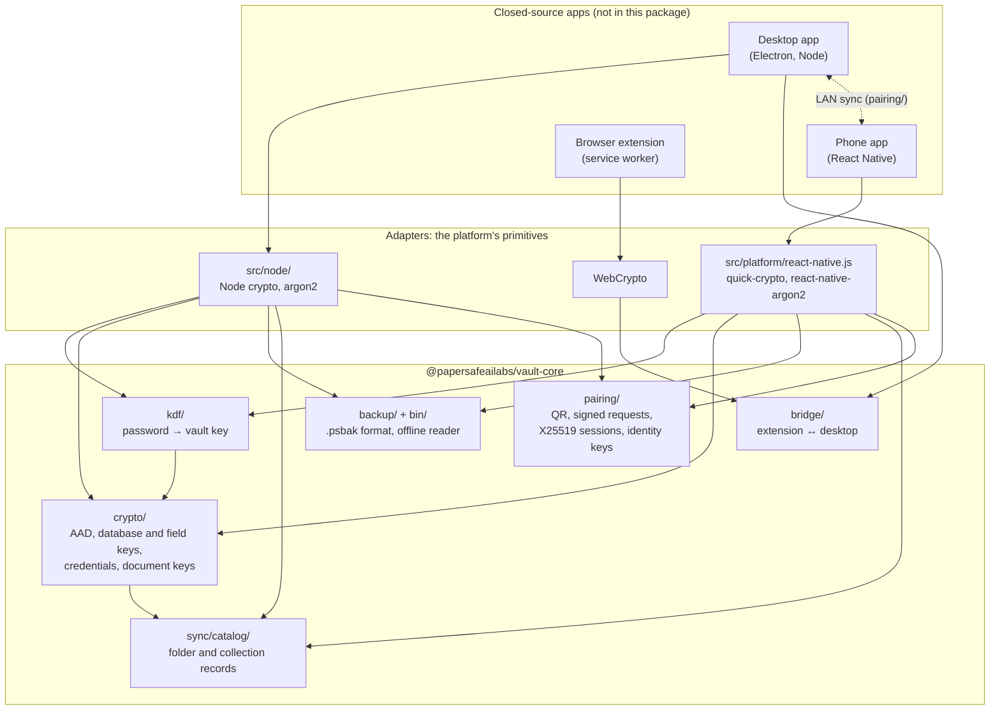

# @papersafeailabs/vault-core

The open-source security core of [PaperSafeAI](https://papersafeai.com): the
code that decides how your documents, passwords and backups are encrypted.

PaperSafeAI encrypts the vault data it stores on your devices. Desktop reading
runs locally; model setup, updates, licence checks and optional phone Cloud
reading have their own network requirements. This package implements the
cryptographic formats, not the app's licensing or cloud services. See
[SPEC.md §10](SPEC.md#10-network-behaviour).

**Source release:** the npm package has not been published yet. You can clone
this repository or install the reviewed source revision directly (Node.js 22+):

```sh
npm install git+https://github.com/PaperSafeAI/vault-core.git#8284ba899e3d60276f729e873fb7469ee01f874b argon2
```

The `@papersafeailabs/vault-core` registry name is reserved for the separate npm
release; do not assume a registry installation is available yet. The source is
provided under Apache-2.0 so developers can inspect and integrate it.

### What publishing this proves, and what it does not

- **It proves the formats.** Every way your vault, backups and synced data are
  encrypted is specified in [`SPEC.md`](SPEC.md), implemented here, and checked
  by test vectors that a reader written from the spec alone can open. Your data
  is readable without us: `papersafe-open-backup` opens a backup with nothing
  but this package and your passphrase.
- **It does not prove that a given app build runs this code.** The PaperSafeAI
  apps themselves are not open source, and their builds are not reproducible.
  The package contains the shared source used by the app integration. The
  planned npm release will include provenance, but you are trusting us that the app you
  installed was built from it. Each app names the core version it bundles
  (desktop: Settings › This Computer; phone: About), so you know which release
  to read.
- **It has not had an independent security audit yet.** See
  [Known limitations](SPEC.md#12-known-limitations) for the trade-offs we know
  about, [THREAT_MODEL.md](THREAT_MODEL.md) for what we claim to protect and
  against whom, and [AUDIT_SCOPE.md](AUDIT_SCOPE.md) for the brief we give
  auditors.

## What's inside

| Path | What it does | Spec |
|---|---|---|
| `src/kdf/` | How your master password or recovery key opens the vault (Argon2id scheme, wrapping key, vault-key unwrap) | [§2](SPEC.md#2-master-password--vault-key) |
| `src/crypto/aad.js` | What every seal is bound to: vault, record type, record, part. The app registers its own record types (`registerRecordTypes`) | [§1](SPEC.md#associated-data) |
| `src/crypto/hardware-wrap.js` | Biometric unlock: the vault key wrapped under a secret only the device's security hardware can produce | [§2](SPEC.md#2-master-password--vault-key) |
| `src/crypto/db-key.js` | The key that encrypts the vault database (SQLCipher) | [§3](SPEC.md#3-database-key) |
| `src/crypto/field-cipher.js` | A second layer of encryption on the most sensitive database columns | [§3](SPEC.md#3-database-key) |
| `src/crypto/vault-cipher.js` | How saved passwords are encrypted and bound to their vault, item and half | [§4](SPEC.md#4-stored-credentials-cipher-suite-3) |
| `src/crypto/credential-keys.js` | Keys for saved passwords, the reused-password check and secure-note search | [§4](SPEC.md#4-stored-credentials-cipher-suite-3) |
| `src/crypto/document-key.js` | A separate key for every document, wrapped and bound to it | [§5](SPEC.md#5-documents) |
| `src/backup/` | The encrypted backup file format: the passphrase envelope, the bundle of files with integrity checks and safe restore paths, format versions and key-derivation limits. The app says where its database sits (`configureBundle`) | [§6](SPEC.md#6-encrypted-backups-psbak-envelope-v3) |
| `src/sync/catalog/` | Encryption of folder and collection records synced to your phone: sync keys, record sealing, and the strict canonical JSON both rely on | [§7](SPEC.md#7-phone--desktop-catalogue-sync) |
| `src/pairing/` | Pairing a phone by QR, signing every request, encrypting every body (and binding answers to requests) between phone and desktop; per-sync X25519 session keys and device identity keys | [§8](SPEC.md#8-pairing-and-phone--desktop-transport) |
| `src/bridge/bridge-crypto.mjs` | End-to-end encryption between the browser extension and the desktop app | [§9](SPEC.md#9-browser-extension--desktop-bridge) |
| `src/platform/react-native.js` | The phone's primitives: the apps hand in react-native-quick-crypto and react-native-argon2 | |
| `src/node/` | Node.js implementations of the primitives (AES-256-GCM, HKDF, HMAC, X25519, Argon2id) | |
| `bin/papersafe-open-backup.js` | Opens a backup without the app | |
| `src/index.js`, `src/version.js` | The package's entry point and its version (shown in the apps) | |

TypeScript declarations ship in `types/`, generated from the JSDoc in `src/`
(`npm run types`; a test fails if they are stale, and `types:check` compiles
them strictly, as a consumer without `skipLibCheck` would).

**Why one ES module among CommonJS.** Everything is CommonJS except
`src/bridge/bridge-crypto.mjs`. The browser extension has to run that exact
file in its service worker, which loads ES modules only, and it is written
against WebCrypto alone for the same reason. The rest is CommonJS because both
apps `require()` it, including the phone's bundler, which takes it as it is.
Both kinds load from either style of project: `require('@papersafeailabs/vault-core')`
or `await import('@papersafeailabs/vault-core/bridge')`, each with its declarations.

The modules never call a crypto library directly; they are handed one. The
desktop app passes Node's `crypto`, the phone passes `react-native-quick-crypto`
behind the same functions. That is what lets one implementation serve both.

## Building another application

See [INTEGRATION.md](INTEGRATION.md) for reusable capabilities, public entry
points, caller responsibilities and compatibility limits. The library is a
security foundation, not the PaperSafeAI app, a complete sync engine or an AI
SDK. The app's `niskumar/vault` branch is its private integration, not a public
dependency.

## How it fits together



The apps call the modules with an adapter; the modules never import a crypto
library themselves. The desktop and the phone share every format, so a vault,
backup or sync record written by one opens on the other. Only `bridge/` is
WebCrypto-only, because the extension runs that exact file.

## Check it yourself

```sh
npm ci                   # the exact versions in package-lock.json
npm run lint             # ESLint (eslint.config.mjs), incl. no Node built-ins outside src/node/
npm test                 # the core's own tests, plus the spec checks below
npm run vectors:check    # the published test vectors still match the code
npm run types:check      # the declarations match src/ and compile strictly
```

- [`SPEC.md`](SPEC.md) describes every format precisely enough to write your
  own reader.
- [`test-vectors/vault-core-v1.json`](test-vectors/vault-core-v1.json) gives
  fixed inputs and the exact bytes the code produces.
- [`test-vectors/bridge-v1.json`](test-vectors/bridge-v1.json) is a recorded
  browser-bridge session, opened in [`test/bridge-crypto.test.js`](test/bridge-crypto.test.js).
- [`test/test-vectors.test.js`](test/test-vectors.test.js) is an independent
  reader written from the spec using only `node:crypto`. Start there if you
  want to write your own implementation.

## Your backups are yours

A PaperSafeAI backup can be opened without the app, offline:

```sh
npm install -g git+https://github.com/PaperSafeAI/vault-core.git#8284ba899e3d60276f729e873fb7469ee01f874b argon2
PAPERSAFE_BACKUP_PASSPHRASE='…' papersafe-open-backup my-vault.psbak ./restored
```

The standalone CLI supports **macOS and Linux**. It refuses native Windows
extraction before reading the backup: POSIX modes cannot guarantee private
Windows ACLs. Use a private POSIX filesystem on a supported OS; Windows app
and core-adapter support are separate from this CLI restriction.

`./restored` must not exist yet: the tool creates it, readable only by you.
Without the environment variable it asks for the passphrase and does not show
it as you type.

## What this is not

This package is PaperSafeAI's encryption formats and key handling, not a
general-purpose crypto library. What the app stores and seals (its record
types, its encrypted columns, where a backup keeps the database) is the app's
own: it registers those with `registerRecordTypes` and `configureBundle`, and
the package's tests use neutral example names. The app's interface, document
AI and search are not part of it. Section 10 of the spec says how to check the
apps' network behaviour yourself; section 12 lists the known limitations.

## Reporting a vulnerability

See [`SECURITY.md`](SECURITY.md). Please don't open a public issue for a
security problem.

## Contributing

See [`CONTRIBUTING.md`](CONTRIBUTING.md). Commits are signed off under the
[Developer Certificate of Origin](https://developercertificate.org/).

## Licence

Apache 2.0. See [`LICENSE`](LICENSE) and [`NOTICE`](NOTICE).

"PaperSafeAI" and its logo are trademarks of PaperSafeAI. The licence covers
the code, not the name or logo: a fork or modified copy must use its own name.
